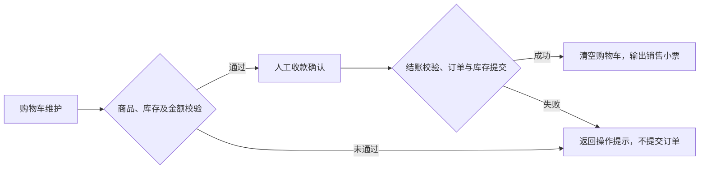
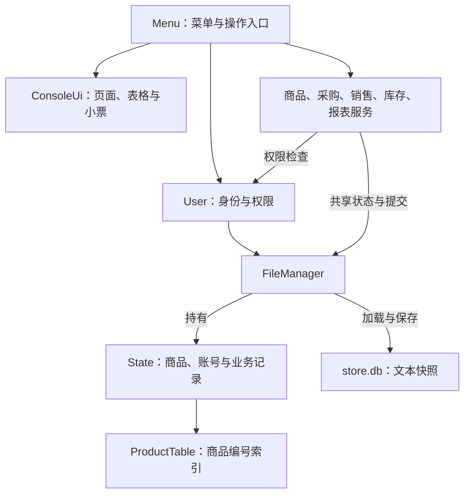
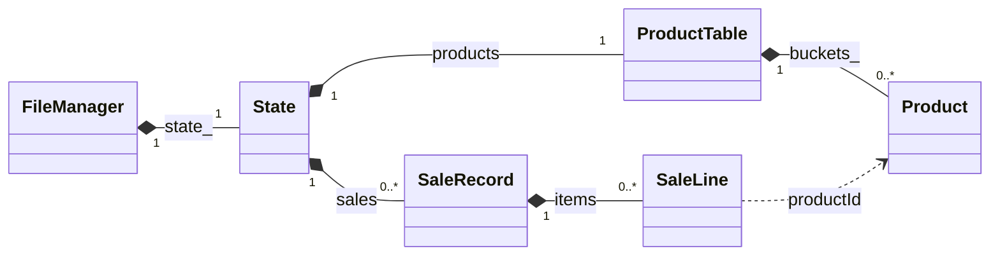

# 小型超市商品进销存管理系统

基于 C++17 的控制台应用，提供商品管理、采购入库、销售收银、库存盘点、经营报表、账号权限及本地备份。构建和测试使用 PowerShell 脚本，商品编号索引使用自行实现的哈希表。

本项目面向小型门店的本地库存与收银管理，采用单机运行方式，同一数据目录仅允许一个进程访问。仓库提供可独立构建的源码、测试和使用说明；首次启动自行创建管理员，不包含真实账号、业务数据或预设管理员密码。

### 功能概览

| 模块 | 已实现能力 |
|---|---|
| 商品管理 | 新增、修改、查询及零库存商品停用；支持商品编号、条码和关键词查询 |
| 采购入库 | 记录入库数量与单价，增加库存并更新参考进价，查询采购历史 |
| 销售收银 | 购物车维护、报价校验、收款确认、找零、销售小票与历史查询 |
| 库存管理 | 实物盘点、差异原因记录、低库存预警及盘点历史 |
| 经营报表 | 按日期统计销售、采购及销售估算毛利，汇总当前库存价值 |
| 账号权限 | 管理员与收银员角色、账号启停、密码修改和服务层权限检查 |
| 数据管理 | 本地文本快照、启动校验、数据目录排他锁和完整快照备份 |

## 1. 获取与更新代码

首次获取，在准备存放项目的位置打开 PowerShell：

```powershell
git clone https://github.com/BlueMustor/supermarket-inventory-cpp-public.git
Set-Location .\supermarket-inventory-cpp-public
```

以后从该仓库目录更新：

```powershell
git pull --ff-only
```

更新源码后请重新构建。若 Git 提示本地有修改或无法快进，先保存并处理自己的修改，再更新，不要直接覆盖。

## 2. 环境准备

当前提供并验证的构建路线是 **Windows + Windows PowerShell + 支持 C++17 的 MinGW-w64**。将编译器的 `bin` 目录加入 PATH，重新打开终端后检查：

```powershell
g++ --version
```

需要显示编译器版本。脚本使用 Windows 系统 BCrypt 和 Shell32，无须额外安装密码库。源码中的其他平台分支尚未在本仓库提供配套构建脚本或实机验证。

下面的所有命令均从**克隆后的仓库根目录**执行，即能看到 `src`、`include`、`scripts` 的目录。

## 3. 构建、运行与测试

构建主程序并运行 C++ 自动测试：

```powershell
powershell -NoProfile -ExecutionPolicy Bypass -File .\scripts\build.ps1 -Test
```

成功后启动：

```powershell
.\bin\supermarket.exe
```

也可以双击根目录的 `运行系统.cmd`。启动器仅在程序不存在时尝试构建；修改或更新源码后，仍需主动执行构建脚本。

只构建主程序时省略 `-Test`。便于断点调试的版本使用：

```powershell
powershell -NoProfile -ExecutionPolicy Bypass -File .\scripts\build.ps1 -Debug -Test
```

`-Debug` 选择 `-O0 -g` 及部分标准库检查；默认构建使用 `-O2`。PowerShell 脚本负责组织工具调用，实际 C++ 编译由 `g++` 完成。脚本每次重新处理源码清单，不维护增量目标文件缓存。

真实可执行程序的菜单流程检查，需在构建成功后单独运行：

```powershell
powershell -NoProfile -ExecutionPolicy Bypass -File .\tests\console_smoke.ps1
```

该脚本使用已有程序，验证交易、重启、中文路径和进程排他等流程。测试中的固定密码仅用于动态创建的测试账号，不是正常运行时的默认密码。测试数据保存在 `build` 内，与正式数据分开。

## 4. 业务流程与首次使用

### 4.1 销售结算流程

销售流程覆盖购物车维护、当前报价校验、人工收款确认、订单与库存提交及小票输出。采购负责补充库存，盘点记录账实差异，经营报表汇总各类已提交记录。



购物车不预扣库存、不锁定价格；结算按当前商品资料重新报价。成功提交会同时保存库存变化和成交记录。普通校验或保存失败时，原有正式状态与购物车保留；取消收款确认也不会生成销售单。收款金额由操作员录入确认，未接入支付平台。

### 4.2 操作示例

首次启动需要创建管理员，之后按提示登录。用户名为 3 至 32 个英文字母、数字或下划线；密码为 8 至 128 个 UTF-8 字节。请自行设置密码。

1. 新增商品，例如条码 `6900000000001`、名称“矿泉水”、分类“饮料”、参考进价 `1.20`、售价 `2.00`、预警值 `5`。新商品库存为 0。
2. 采购入库 20 件，单价 `1.20`；库存变为 20，采购金额为 24.00 元。
3. 创建收银员账号，切换登录；向购物车加入该商品 3 件。
4. 实收 `10.00` 并确认结算，应收 6.00 元、找零 4.00 元，库存变为 17。
5. 切回管理员，盘点实物为 16，填写差异原因；库存改为 16 并留下盘点记录。
6. 查看报表，创建备份，退出并重启，核对历史记录与库存。

新空目录的第一件商品为 `P000001`。复用已有目录时以实际编号为准；若要从零重做演示，请换一个新的练习数据目录，避免重复条码或重复入库。

菜单使用数字后按 Enter 选择，操作结束按 Enter 继续，输入 `0` 返回。提交时输入 `y` 确认。管理员维护商品、采购、盘点、报表、账号和备份；收银员查询在售商品、收银并查询自己的销售记录。业务服务内部也会检查权限。

## 5. 数据目录与备份

默认数据位于可执行文件旁的 `data`，正式入口对应 `bin/data`。其中 `store.db` 是 UTF-8 文本快照，保存账号、商品和业务流水，并非数据库服务。

查看启动参数：

```powershell
.\bin\supermarket.exe --help
```

指定独立练习目录：

```powershell
.\bin\supermarket.exe --data-dir .\build\demo-data
```

`--data-dir` 是程序参数；相对路径按启动时的当前目录解释。切换目录会使用另一套账号与数据，不会搬移原数据。

管理员通过菜单创建完整快照备份。恢复时先退出使用该数据目录的所有程序，另存当前 `store.db`，再将选定完整备份复制为 `store.db`，重启核对。备份后的新增记录不在旧备份中。

业务数据、备份、日志、编译产物和本机配置均已列入忽略规则。不要手改正式库存来代替采购或盘点；程序会检查流水重放后的库存一致性。

## 6. 系统架构与工程结构

### 6.1 模块关系

系统由控制台交互、业务服务、共享状态及文件存储组成。`Menu` 组织操作入口，`ConsoleUi` 负责显示；业务规则集中在服务中，状态提交与文件管理由 `FileManager` 统一处理。



| 主要类型 | 职责 |
|---|---|
| `ProductManager` | 商品资料维护、编号/条码/关键词查询及停用规则 |
| `PurchaseManager` | 采购确认、库存增加与采购记录 |
| `SaleManager` | 购物车、报价、整单结算及销售记录 |
| `InventoryManager` | 盘点调整、低库存查询及盘点记录 |
| `ReportManager` | 销售、采购、库存汇总 |
| `User` | 登录身份、账号维护与权限约束 |
| `FileManager` | 状态持有、快照校验、保存、备份及目录锁 |
| `ProductTable` | 手写哈希表的分桶、冲突处理、查找和扩容 |

采购、销售与盘点服务通过 `ProductManager` 查询商品，各服务借用同一个文件管理器和身份服务。模块图按职责分组，完整接口见 [services.hpp](include/supermarket/services.hpp)。

### 6.2 核心数据关系

`State` 集中保存商品、账号及采购、销售、盘点记录。下图选取商品和销售记录的主要关系；实线菱形表示成员持有，虚线表示按商品编号关联。



销售明细按商品编号关联，同时保留成交时名称、售价和参考成本。修改当前商品资料不会改变历史单据。

### 6.3 关键设计

- **商品索引：** 自行实现基于商品编号的哈希表，采用分离链接处理冲突并支持扩容；条码和关键词查询通过遍历完成。
- **金额计算：** 使用 64 位整数“分”及范围校验，交易与汇总计算检查溢出。
- **状态一致性：** 修改发生在候选状态中，完成校验、临时快照写入和正式文件替换后，再更新正式内存状态。
- **历史可追溯：** 采购、销售和盘点保留操作信息及业务快照；文件加载校验历史引用、金额和库存重放结果。
- **身份与资源管理：** 服务入口检查权限，密码使用带随机盐的 PBKDF2 派生结果保存，文件和锁通过对象生命周期管理。

### 6.4 工程目录

```text
include/supermarket/    业务模型、服务接口、哈希表与控制台组件
src/                   模块实现与程序入口
tests/                 C++ 自动测试、PowerShell 菜单流程检查
scripts/build.ps1      Windows 构建与测试入口
运行系统.cmd            双击启动入口
build/                 构建产物、测试数据和输出，不纳入版本管理
bin/                   正式可执行程序及默认业务数据，不纳入版本管理
```

## 7. 业务边界与验证范围

- 新增资料不产生库存；采购增加、销售减少、盘点设置实盘数量并留痕。
- 购物车不预扣库存，结算重新检查；停用商品保留历史和条码，且停用时库存须为 0。
- 销售明细保存当时名称、售价和参考成本，后续改价不重算旧小票。毛利按成交时参考成本估算，未扣除租金等费用。
- 单价、交易金额及报表累计有上限；越界和非法输入会拒绝操作。
- 一个数据目录只允许一个进程使用。普通保存失败保留旧状态；未实现数据库日志、并发写入或严格断电恢复协议。

Windows + MinGW-w64 GCC 14.2.0 下，核心测试为 **36 个用例、665 项断言**，菜单流程分为 **6 组检查**。覆盖金额、输入、权限、哈希表、交易、持久化、备份、保存失败和界面文本等行为。测试不涵盖所有平台和所有故障场景。

## 8. 常见问题

| 现象 | 优先检查 |
|---|---|
| 找不到 `g++` | 编译器是否安装、其 `bin` 是否加入 PATH，修改后是否重开终端 |
| 找不到脚本或程序 | 当前是否位于仓库根目录，是否已构建成功 |
| 缺少头文件或链接实现 | 使用完整构建脚本，避免仅在编辑器中构建当前文件 |
| 源码改了但程序没变化 | 保存后重新构建，确认本次成功并启动正确的 `bin/supermarket.exe` |
| 提示数据目录正被使用 | 关闭使用相同目录的另一个实例，或指定不同数据目录 |
| 意外出现首次建号界面 | 核对启动命令和数据目录，可能使用了另一套目录 |
| 现有数据加载失败 | 保留当前文件并核对备份，不把损坏文件当空数据覆盖 |

正常退出后 `.market.lock` 文件仍可能存在，实际锁由操作系统管理；仅看文件是否存在不能判断进程是否占用。
